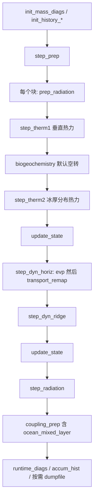

# gx3 条件下 CICE 的代码执行顺序

gx3 不另写一套程序。它只改 namelist 里的网格、初值和强迫文件；可执行文件的入口和调用顺序与其它网格相同。默认物理是：EVP 动力学（`kdyn = 1`）、remap 平流、5 类冰厚、mushy 热力、delta-Eddington 短波。积雪再分布、碎冰尺度和生物地球化学默认关闭，对应子程序不会进入。

## main 是什么

独立运行时，`program icemodel` 在 `cicecore/drivers/standalone/cice/CICE.F90`。它只做三件事：

```fortran
call CICE_Initialize
call CICE_Run
call CICE_Finalize
```

作业脚本在这之前：`cice.submit` 提交 `cice.run`，后者把 case 目录里的 `ice_in`、`cice.settings`、`env.[机器]` 拷进运行目录，再启动名为 `cice` 的可执行文件（`ICE_TARGET`）。

gx3 的数据由 `configuration/scripts/options/set_nml.gx3` 写入 `ice_in`：100×116 的 displaced-pole 网格，`grid_gx3.bin`、`kmt_gx3.bin`，初值 `iced_gx3_v5.nc`，大气 JRA55（netCDF），海洋强迫为二进制。`runtype = 'initial'`，但 `ice_ic` 是文件路径，读 namelist 时会把 `restart` 设为真，所以海冰状态从该重启文件读入。冰龄、一年冰、level ice、融池的 `restart_*` 仍是 `.false.`，这些示踪物在代码里重新初始化。

## 初始化：`CICE_Initialize` → `cice_init`

文件：`cicecore/drivers/standalone/cice/CICE_InitMod.F90`

| 顺序 | 调用 | 所在文件 | 作用 |
|---|---|---|---|
| 1 | `init_communicate` | `cicecore/cicedyn/infrastructure/ice_communicate.F90` | 启动 MPI |
| 2 | `init_fileunits` | `cicecore/cicedyn/infrastructure/ice_fileunits.F90` | 分配 I/O 单元号 |
| 3 | `icepack_configure` | `icepack` 的 `icepack_intfc` | 初始化柱物理库 |
| 4 | `input_data` | `cicecore/cicedyn/general/ice_init.F90` | 读 `ice_in` 并广播；gx3 在这里确定网格文件和 `restart=.true.` |
| 5 | `input_zbgc` / `count_tracers` | `cicecore/shared/ice_init_column.F90` | 读生物地球化学 namelist，统计示踪物个数 |
| 6 | `init_domain_blocks` | `cicecore/cicedyn/infrastructure/ice_domain.F90` | 按 `domain_nml` 切块（gx3 默认 100×116，块 25×29） |
| 7 | `init_grid1` | `cicecore/cicedyn/infrastructure/ice_grid.F90` | 把块分到各 MPI 进程 |
| 8 | `alloc_grid` / `alloc_arrays_column` / `alloc_state` / `alloc_flux*` | `ice_grid.F90`、`ice_arrays_column.F90`、`ice_state.F90`、`ice_flux.F90` | 分配网格、柱物理、状态、通量数组 |
| 9 | `init_ice_timers` | `cicecore/cicedyn/infrastructure/ice_timers.F90` | 计时器 |
| 10 | `init_grid2` | `ice_grid.F90` | 读 `grid_gx3.bin`、`kmt_gx3.bin`，算面积、掩膜、科氏力 |
| 11 | `init_zbgc` | `ice_init_column.F90` | 垂直生物地球化学结构（默认关闭，仍做初始化） |
| 12 | `init_calendar` | `cicecore/shared/ice_calendar.F90` | 日历；gx3 从 2005-01-01 起，步长 3600 s |
| 13 | `init_hist` | `cicecore/cicedyn/analysis/ice_history.F90` | 历史输出流 |
| 14 | `init_evp` | `cicecore/cicedyn/dynamics/ice_dyn_evp.F90` | `kdyn=1`，准备 EVP |
| 15 | `init_coupler_flux` | `ice_flux.F90` | 与大气/海洋交换的通量初值 |
| 16 | `init_thermo_vertical` | `ice_init_column.F90` | 垂直热力（`ktherm=2`，mushy） |
| 17 | `icepack_init_itd` | icepack | 5 类冰厚分布边界 |
| 18 | `init_forcing_ocn` | `cicecore/cicedyn/general/ice_forcing.F90` | 海洋 SST/SSS 初值 |
| 19 | `init_state` | `ice_init.F90` | 海冰状态数组初值（随后会被重启文件覆盖） |
| 20 | `init_transport` | `cicecore/cicedyn/dynamics/ice_transport_driver.F90` | remap 平流准备 |
| 21 | `init_restart` | 仍在 `CICE_InitMod.F90` | 读 `iced_gx3_v5.nc`；未重启的示踪物在此初始化，再 `icepack_aggregate` 聚合成网格平均 |
| 22 | `init_diags` / `init_history_therm` / `init_history_dyn` | `ice_diagnostics.F90`、`ice_flux.F90` | 诊断点和历史场 |
| 23 | `calc_timesteps` | `ice_calendar.F90` | 把 `npt` 换成步数（默认 `npt_unit='1'`、`npt=24`，即 24 步） |
| 24 | `icepack_init_radiation` 然后 `init_shortwave` | icepack、`ice_init_column.F90` | 短波表；因 `restart=.true.`，用上一时刻短波初始化 |
| 25 | `advance_timestep` | `ice_calendar.F90` | 时钟推到第一个时间步末 |
| 26 | `init_forcing_atmo`、`get_forcing_atmo`、`get_forcing_ocn` | `ice_forcing.F90` | 读 gx3 的 JRA55 大气和二进制海洋强迫 |
| 27 | `init_flux_atm` / `init_flux_ocn` | `ice_flux.F90` | 准备本步要交给耦合器的通量 |
| 28 | `dealloc_grid` | `ice_grid.F90` | 释放临时网格数组 |

`init_restart` 里实际读文件的是 `cicecore/cicedyn/general/ice_restart_driver.F90` 的 `restartfile(ice_ic)`。

## 时间循环：`CICE_Run` → `ice_step`

文件：`cicecore/drivers/standalone/cice/CICE_RunMod.F90`。`timeLoop` 一直转到 `stop_now >= 1`（默认 24 个热力步）。每步先 `ice_step`，再 `advance_timestep`，然后为下一步读强迫。

`ice_step` 的物理顺序：



这些子程序都在 `cicecore/cicedyn/general/ice_step_mod.F90`，内部再调 icepack 柱物理：

| 子程序 | 下一步调用 | 功能 |
|---|---|---|
| `prep_radiation` | `icepack_prep_radiation` | 用当前短波缩放辐射场（`calc_Tsfc=.true.`） |
| `step_therm1` | `icepack_step_therm1` | 表面能量平衡、增长/融化、盐度 |
| `biogeochemistry` | `icepack_biogeochemistry` | 默认 `skl_bgc`、`z_tracers` 都关，几乎不做计算 |
| `step_therm2` | `icepack_step_therm2` | 冰厚分类之间的再分布（`kitd=1`） |
| `update_state` | `icepack_aggregate` | 清理负面积、聚合示踪物、记热力/动力倾向 |
| `step_dyn_horiz` | `evp`（`ice_dyn_evp.F90`）再 `transport_remap`（`ice_transport_driver.F90`） | 动量（`ndte=240` 次 EVP 子循环：`stress` + `stepu`），然后水平输运。`ndtd=1`，动力子循环只走一轮 |
| `step_dyn_ridge` | `icepack_step_ridge` | 脊化（`kridge=1`） |
| `step_radiation` | `icepack_step_radiation` | 反照率和短波（`shortwave='dEdd'`，`albedo_type='ccsm3'`） |
| `coupling_prep` | `ocean_mixed_layer` → `icepack_ocn_mixed_layer` | 更新混合层 SST，把通量按冰面积缩放，准备耦合 |

写出在步末：`runtime_diags`（`ice_diagnostics.F90`，默认每 24 步一次）、`accum_hist`（`ice_history.F90`）、需要重启时 `dumpfile`（`ice_restart_driver.F90`）。

步与步之间，`CICE_Run` 再调 `get_forcing_atmo`、`get_forcing_ocn`，然后 `init_flux_atm`、`init_flux_ocn`。

默认不会进入：`step_dyn_wave`（碎冰+海浪）、`step_snow`（`tr_snow=.false.`）、`ice_HaloRestore`（`restore_ice=.false.`）、EAP/VP 求解器（`kdyn` 不是 2 或 3）。

## 结束：`CICE_Finalize`

文件：`cicecore/drivers/standalone/cice/CICE_FinalMod.F90`

1. `ice_timer_stop` / `ice_timer_print_all`：停总时钟并打印计时
2. 写 `CICE COMPLETED SUCCESSFULLY`
3. `release_all_fileunits`：关文件
4. `end_run`（`ice_exit.F90`）：退出 MPI
